# 02 — Architecture

```mermaid
flowchart LR
  S[Synthetic generator] --> A
  A[Hyperspectral cubes<br/>HDF5 / GeoTIFF] --> B[Geospatial Pipeline<br/>Rasterio+GDAL]
  B --> C[Preprocess<br/>clean, normalise, PCA]
  C --> D[Patch Dataset / Tiles]
  D --> E[3D-CNN Stem]
  E --> F[Spectral ViT Encoder]
  F --> G[Heads: class, severity, forecast]
  G --> H[Zone detection<br/>polygonize]
  H --> I[FastAPI]
  I --> J[React + Deck.gl Dashboard]
```

## Components
- **data/**: readers (GeoTiffReader, Hdf5Reader), window iterators, GDAL helpers, preprocessing, PCA, datasets, splits, augmentations.
- **synth/**: physically-inspired spectra, stress/disease model, spatial fields, cube assembly, CLI.
- **models/**: Conv3D blocks, SE spectral attention, SpectralViT, HybridCNNViT, temporal encoder, heads.
- **training/**: trainer, losses, metrics, callbacks, experiment logging.
- **inference/**: tiling, stitching (Hann blending), batching with OOM backoff, zone extraction.
- **api/**: app factory, routers, schemas, job manager, caching, security.
- **web/**: map, layers, panels, charts, timeline, API client, state.

## Inference data flow
scene_id → catalog → windowed read → preprocess (same stats + PCA as training) → overlapping tiles →
GPU batches → per-tile probability/severity/forecast → Hann-weighted stitch → georeferenced GeoTIFF +
GeoJSON risk zones + analytics JSON → cached → API → dashboard.

## Key design decisions
1. PCA (default 32 components) reduces 200+ bands BEFORE the network to bound memory; raw-band path kept for ablation.
2. ViT tokens = groups of spectral feature slices with wavelength-aware positional encoding.
3. Multi-task heads: 3-class state, severity [0,1], days-to-symptoms (forecast).
4. Tiling uses overlap + Hann weights to avoid seams.
5. Jobs are async; results cached by hash(scene, model_version, params).
